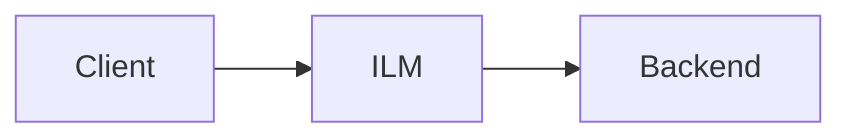

# MD Portal — generatore Markdown → HTML

Versione 4.3. Generatore generico in Python ispirato alla struttura del portale doc-pack: un unico HTML con pagine, indice ad albero, sommario per pagina, ricerca full-text, tema chiaro/scuro, stampa e copia del codice. Nessuna risorsa web necessaria per l'interfaccia.

## Requisiti

Python 3.10 o successivo. Da PowerShell, nella cartella estratta:

```powershell
py -m pip install -r requirements.txt
```

Su Linux/macOS usare `python3` al posto di `py`. Chromium serve solo sulla macchina che genera il portale, e solo se contiene formule/diagrammi da prerenderizzare. Chrome, Edge e Chromium locali sono rilevati automaticamente. Solo se non è disponibile alcun browser compatibile, installare Chromium con `py -m playwright install chromium` oppure indicare un eseguibile con `--browser-path`. Per la modalità storica `--render-mode runtime` non serve Chromium al build. Nessuna installazione per il destinatario.

## Esempi di utilizzo

Un file:

```powershell
py md_portal.py "C:\Documenti\README.md" -o documentazione.html --title "Documentazione tecnica"
```

Più file:

```powershell
py md_portal.py README.md ARCHITECTURE.md "doc\stack.md" -o documentazione.html --title "Progetto"
```

Tutti i Markdown di una directory, comprese le sottocartelle:

```powershell
py md_portal.py "C:\Progetti\MPU\docs" -o MPU-docs.html --title "MPU"
```

Demo inclusa:

```powershell
py md_portal.py esempio -o demo.html --title "SBE Next — Portale documentazione" --strict
```

Aprire l'HTML con un doppio clic. Si può distribuire il singolo HTML, senza Python né file SVG separati sul PC del destinatario.

## Opzioni

| Opzione | Funzione |
|---|---|
| `-o`, `--output` | Percorso dell'HTML (default `docs.html`) |
| `--title` | Nome del portale |
| `--root` | Directory base per percorsi e risorse locali; default antenato comune degli input |
| `--home` | Documento iniziale, percorso relativo alla root con `/` |
| `--strict` | Interrompe la generazione se vi sono avvisi (riferimenti mancanti, immagini remote, YAML non valido) |
| `--no-mermaid` | Mantiene i diagrammi come codice e non incorpora la libreria |
| `--no-dashboard` | Disabilita la pagina Funzionalità, senza eliminare i metadati |

I file README.md e index.md hanno precedenza nella selezione della pagina iniziale. Le cartelle nascoste, git, node_modules, venv, bin e obj sono escluse. L'indice riproduce la struttura delle directory. I titoli vengono ricavati dal primo H1, o dal nome del file.

## Funzionalità e limiti

- Markdown CommonMark, tabelle, testo barrato, liste, immagini e blocchi di codice con syntax highlighting Pygments.
- Collegamenti relativi fra documenti inclusi e alle relative sezioni; gestione di titoli ripetuti mediante suffissi numerici.
- Immagini e allegati locali incorporati come data URI, purché dentro la root. Gli allegati vengono proposti come download. I collegamenti Markdown verso file non inclusi sono segnalati.
- Immagini remote non scaricate: necessitano di rete e producono un avviso; con `--strict` interrompono il build. I normali link web rimangono link web.
- L'HTML grezzo nei Markdown è disabilitato. I blocchi Mermaid vengono renderizzati offline e i metadati delle funzionalità alimentano una dashboard automatica (vedi sotto).
- Ricerca senza distinzione maiuscole e accenti, su titolo, percorso e testo; scorciatoie `/` e `Ctrl+K`. I primi 100 risultati sono visualizzati.
- Layout responsive; il sommario destro è nascosto su schermi stretti. Stampa la pagina corrente.
- Tutto il materiale incluso è leggibile nel sorgente dell'HTML: non usarlo come sistema di controllo degli accessi. La directory root delimita le risorse locali incorporabili; verificare i contenuti prima di distribuire il file.
- Non c'è una garanzia di compatibilità con tutti i visualizzatori HTML incorporati; utilizzare Chrome, Edge o Firefox moderni.

## Mermaid offline

Usare un normale blocco Markdown recintato con linguaggio `mermaid`:

````markdown

````

Nella modalità storica `--render-mode runtime` la libreria viene incorporata nell'HTML solo quando esistono diagrammi; è caricata al primo diagramma, senza CDN. Il cambio tema ridisegna i diagrammi. Il pulsante Sorgente mostra/nasconde il codice originale, Copia lo copia. Gli errori di sintassi sono mostrati in pagina insieme al sorgente: `--strict` verifica riferimenti e metadati al build, non la sintassi Mermaid (il rendering avviene nel browser). Modalità di sicurezza Mermaid `strict`, senza binding dei callback dei diagrammi. Usare sorgenti fidate; configurazioni Mermaid che richiedono icone, immagini o altre risorse esterne non sono garantite offline.

In modalità runtime, con Mermaid l'HTML aumenta di circa 5,5 MB prima della compressione; in modalità statica vengono inclusi solo gli SVG;  senza diagrammi o con `--no-mermaid` non vi è tale incremento. Il bundle proviene dal file HTML originale fornito dall'utente, non da una CDN; vedere `vendor/PROVENANCE.md`. Per usare il generatore conservare la cartella `vendor/`.

## Metadati e dashboard

Il front matter YAML è opzionale, all'inizio del documento, delimitato da `---`:

```yaml
---
type: feature
id: TKT-0001
title: Validazione titolo
service: ticketing
status: in corso
version: '1.1'
author: Team AFC
owner: Team AFC
tags: [gRPC, validazione]
depends_on: [CAT-0001]
enables: [TKT-0002]
---
```

Gli stati riconosciuti sono `da fare`, `in corso`, `fatta`, `bloccata`, `abbandonata` (anche alias inglesi `todo`, `in progress`, `done`, `blocked`, `cancelled`). Gli stati non riconosciuti sono mostrati come dichiarati; se assenti, `non specificato`. Sono supportati anche i nomi italiani dei campi: `titolo`, `servizio`, `stato`, `versione`, `autore`, `responsabile`, `etichette`, `dipende_da`, `abilita`. Indicare versioni con apici per preservare la stringa esatta.

La dashboard è generata se si trova almeno una funzionalità: documenti con `type: feature` o `id`, oppure file con ID iniziale (es. `TKT-0001_...md`, `F12_...md`) in una cartella `features` o `funzionalita`. Per questi ultimi riconosce anche `**Stato**: da fare` e `**Stato:** da fare` e tabelle Markdown con intestazioni o righe `Dipende da` / `Abilita`. Il servizio è dedotto da `apps/<servizio>` o dalla cartella sopra `doc/features`, se non dichiarato. Il titolo usa il front matter, il primo H1 o il nome file. I documenti ordinari privi di questi elementi restano invariati.

- Pagina **Funzionalità**: totale e conteggi per stato, filtri per servizio, stato, ID/titolo/tag, raggruppamento per servizio, versione, collegamenti alle dipendenze.
- I collegamenti delle dipendenze vengono risolti per ID, preferendo lo stesso servizio se l'ID non è qualificato. Per specificare un altro servizio usare `servizio:ID` (tra apici in YAML); riferimenti non risolti o ambigui restano testo.
- I metadati sono visualizzati sotto il titolo; il menu mostra un indicatore di stato. I metadati sono ricercabili.
- La percentuale completata conta le funzionalità con stato `fatta`, non la complessità o l'effort.

Questa è una convenzione generica compatibile con i principali elementi del formato SBE Next, non una replica completa del suo renderer proprietario (ad esempio schede user story e diagrammi roadmap con link automatici non sono implementati).

## Verifiche della demo

Generazione strict: 6 Markdown, 7 SVG, 2 diagrammi Mermaid e 3 funzionalità fittizie; nessun avviso. Verificati con Chromium e Playwright, senza rete, filtri per servizio/stato, navigazione delle dipendenze, diagrammi flowchart e sequence, pulsante Sorgente, cambio tema e ricerca per ID; nessun errore JavaScript non gestito. Test tramite caricamento HTML in memoria: l'accesso diretto file:// è bloccato da una policy amministrativa dell'ambiente di test, quindi non verificato direttamente.


## Novità 3.0 — allegati, dati e compressione

Il portale incorpora i file locali esplicitamente collegati (`[Dati](data/tabella.csv)`) e le immagini. Inoltre riconosce i riferimenti in codice inline: `data/tabella.csv`, `tabella.csv` (solo se il nome è univoco), `data/reference/` (tutti i file non Markdown della directory e sottodirectory). Non analizza i blocchi di codice, né scarica risorse esterne. I riferimenti impliciti inesistenti vengono ignorati perché possono essere esempi o nomi di file da produrre; per verificare obbligatoriamente un allegato utilizzare un link Markdown esplicito e `--strict`. I nomi ambigui generano un avviso (errore in strict). I riferimenti fuori dalla root, file nascosti e directory escluse non vengono incorporati. Attenzione: indicare una directory significa autorizzare l'inclusione di tutti i suoi file non Markdown ammessi; usare `--no-implicit-assets` per includere esclusivamente collegamenti espliciti e immagini.

Il catalogo **Allegati incorporati** compare a fine pagina, con link di download, dimensione e anteprima CSV/TSV. L'anteprima assume che la prima riga sia l'intestazione, riconosce delimitatori virgola, punto e virgola, tab e pipe, gestisce campi tra virgolette e mostra al massimo 200 righe dati e 100 colonne (singole celle limitate a 2000 caratteri; anteprima disabilitata per file oltre 20 MiB). La ricerca opera sulle righe mostrate. Il download contiene sempre i byte originali, senza conversioni, inclusi BOM e fine riga. Gli altri tipi di file sono scaricabili senza anteprima. Gli asset sono deduplicati per SHA-256 e MIME, memorizzati una volta in un registro e materializzati dal browser come Blob URL. Non è prevista l'esecuzione di file allegati.

### Esempio

```powershell
py md_portal.py "C:\Progetti\Documentazione" --title "Documentazione tecnica" -o documentazione.html --strict --report report.json
```

### Opzioni aggiunte

| Opzione | Effetto |
|---|---|
| `--compression auto` | Default. Benchmark automatico delle combinazioni disponibili; seleziona il file HTML finale più piccolo, oppure quello non compresso. |
| `--compression gzip` | Forza il contenitore gzip autocontenuto, anche se più grande. |
| `--compression none` | HTML normale, senza bootstrap, con minificazione attiva. |
| `--no-minify` | Disattiva la minificazione di template, JSON, JS e CSS. Indipendente dalla compressione. |
| `--no-implicit-assets` | Disattiva riferimenti impliciti a file/directory. |
| `--report report.json` | Manifest delle risorse con SHA-256, dimensioni per fase, modalità e motori di minificazione. |

Per compatibilità con browser datati o policy aziendali che bloccano la decompressione/script inline: `--compression none`. Per ottenere il riferimento non minificato: `--compression none --no-minify`. L'HTML compresso è sempre un normale file `.html`, non un `.gz`; il browser deve supportare JavaScript e, per GZIP/DEFLATE, `DecompressionStream`; Brotli e LZMA usano decoder integrati. L'intero documento viene decompresso all'apertura, quindi la dimensione su disco non equivale alla RAM utilizzata. Non è necessario un server o una CDN. Il bundle Mermaid, già minificato e con licenze, resta nella cartella vendor ed è incluso nel portale solo in modalità runtime se usato. Per CSS e JS si utilizzano rcssmin/rjsmin se installati; in loro assenza il generatore applica una compattazione conservativa e lo dichiara nel report. Nessun file dati o immagine viene ricodificato con perdita.

Il report stampa dimensione prima/dopo minify, dimensione finale effettiva (incluso overhead della codifica, del decoder e del bootstrap), percentuale di risparmio e dimensione gzip binaria separata. Il baseline è l'HTML v4 non minificato contenente gli stessi dati, non lo ZIP dei sorgenti.

## Novità 4.0 — benchmark multi-algoritmo e multi-codifica

La modalità predefinita `--compression auto --profile maximum --encoding auto` confronta anche l'HTML non compresso. I candidati sono confrontati per **byte reali del documento HTML completo**: payload, codifica ASCII, decoder e bootstrap. Tutti i dati rimangono lossless. Il formato è un normale HTML autocontenuto; non richiede Node.js, server o connessione Internet per la consultazione.

| Algoritmo | Livello | Decoder | Profilo |
|---|---|---|---|
| gzip | 9 | DecompressionStream gzip | entrambi |
| deflate | 9 (raw) | DecompressionStream deflate-raw | entrambi |
| zopfli | 5 iterazioni, configurabili | DecompressionStream gzip | entrambi |
| brotli | 11 (text) | bundle JS offline | maximum |
| lzma | 9, LZMA1 raw (lc=3, lp=0, pb=2) | decoder JS offline | maximum |
| zstd | 22 | decoder fzstd UMD opzionale, fornito dall'utente | maximum |

Zopfli produce un flusso GZIP valido. LZMA usa un flusso LZMA1 raw, non un archivio XZ. Base85 e Base91 usano alfabeti ASCII adattati per l'incorporazione in un elemento script raw-text, senza il carattere `<`; non sono formati di scambio interoperabili con tutti i decoder Base85/Base91 esterni. Base64 rimane disponibile. La codifica esterna non cambia i byte originali degli allegati, che continuano a utilizzare il registro v3. Il decoder viene incluso esclusivamente se selezionato. `auto` non include una seconda copia di fallback del payload.

### Opzioni 4.0

| Opzione | Descrizione |
|---|---|
| `--profile maximum` | Default; valuta anche i decoder JS offline |
| `--profile compatible` | Solo GZIP, Zopfli, DEFLATE raw; richiede comunque browser moderno |
| `--compression auto` | Cerca il minimo finale; `gzip`, `deflate`, `zopfli`, `brotli`, `lzma`, `zstd`, `none` per forzare un algoritmo |
| `--encoding auto` | Prova Base64, Base85, Base91; `base64`, `base85`, `base91` per forzare una codifica |
| `--zopfli-iterations 15` | Aumenta il lavoro di compressione; default 5 |
| `--zstd-decoder percorso.js` | Percorso di un bundle UMD locale fzstd che esponga `globalThis.fzstd.decompress(Uint8Array)` |
| `--report report.json` | Tabella di tutti i candidati, payload/encoded/decoder/overhead/final bytes, rapporti, percentuali, tempi, esclusioni e vincitore |

```powershell
py -m pip install -r requirements.txt
py md_portal.py docs -o documentazione.html --strict --report report.json
py md_portal.py docs -o compatibile.html --profile compatible --report compatibile.json
py md_portal.py docs -o massimo.html --compression lzma --encoding base91
py md_portal.py docs -o standard.html --compression gzip --encoding base64
py md_portal.py docs -o normale.html --compression none
```

### Zstandard (opzionale)

Il compressore usa `zstandard` oppure il comando `zstd` se presente. Il decoder browser Zstandard **non è distribuito** in questo pacchetto, quindi il benchmark può misurare il payload ma non lo seleziona. Per abilitarlo, procurarsi un bundle fzstd UMD da https://github.com/101arrowz/fzstd (verificare versione, provenienza e licenza), conservarlo in locale e passarlo al generatore:

```powershell
py md_portal.py docs -o zstd.html --compression zstd --zstd-decoder vendor/fzstd.umd.js --report zstd.json
```

Con `--compression auto --zstd-decoder ...` Zstandard concorre anche alla selezione automatica. Il bundle fornito è codice JavaScript eseguito dal browser: usare esclusivamente file fidati e testare l'output prima della distribuzione. Questa integrazione opzionale non è stata verificata con un decoder reale. L'algoritmo esplicitamente richiesto, se non disponibile, produce un errore invece di ripiegare silenziosamente su GZIP.

### Note sui report

`payload_ratio` = byte minificati / byte del flusso compresso; `final_ratio` = byte minificati / byte HTML candidato. `reduction_percent` per candidato è rispetto all'HTML minificato; `total_reduction_percent` è rispetto all'HTML iniziale non minificato. `wrapper_overhead_bytes` include decoder, bootstrap e markup, ma non la codifica del payload (già riportata in `encoded_bytes`); `decoder_bytes` è un suo sottoinsieme. `compression_seconds` è il tempo dell'algoritmo, condiviso dalle sue tre codifiche, e non va sommato tre volte. `encoding_seconds` comprende codifica, wrapper e misurazione. I tempi sono orientativi e dipendono dalla macchina; non sono tempi di apertura del browser. In caso di parità vince il primo candidato; la modalità auto mantiene il documento non compresso se non c'è un risparmio.

### Verifiche del rilascio 4.0

Chromium 144, Playwright, contenuto caricato senza rete: tutte le 15 combinazioni dei cinque algoritmi inclusi e delle tre codifiche hanno ripristinato correttamente un documento di test con Unicode e markup. Test aggiuntivi di round-trip LZMA/Brotli su byte casuali e ripetitivi. Due documenti reali in modalità strict senza avvisi: UsticaRadar (2 Markdown, 8 PNG, 16 CSV), demo SBE Next (6 Markdown, dashboard e 2 diagrammi Mermaid). Verificati rendering dei due diagrammi, apertura della dashboard (presenza nell'indice), anteprima CSV e identità byte per byte dei 24 asset UsticaRadar dopo decompressione. Nessun pageerror nei test. Apertura diretta file:// e salvataggio dei download non verificabili per policy dell'ambiente. I minificatori rjsmin/rcssmin non erano installati nell'ambiente di test; i report mostrano il fallback conservativo. Zstandard è stato misurato via CLI, ma escluso dalla selezione in assenza di decoder browser. Non è stata verificata la compatibilità su tutti i browser/OS. Per problemi usare `--profile compatible --encoding base64` oppure `--compression none`.


## Novità 4.1 — formule LaTeX e report coerente

Il parser riconosce `$...$`, `$$...$$` (anche su più righe), `\(...\)` e `\[...\]`, prima che Markdown interpreti backslash, underscore e altri caratteri matematici. I blocchi di codice e il codice inline non vengono interpretati come formule. Per un dollaro letterale usare `\$`.

Nella modalità storica runtime, MathJax 3.2.1 (TeX → SVG, pacchetti base/AMS/newcommand/textmacros) è incluso offline solo se il documento contiene formule: nessun font esterno, CDN, Node.js o nuova dipendenza Python. Il rendering avviene alla visualizzazione della pagina, anche in tema scuro; formule non valide restano visibili come sorgente con indicazione di errore. Le formule SVG possono essere stampate. Il bundle aumenta il peso del portale con formule; per disabilitarlo usare `--no-math`.

Il riepilogo stampa il payload dell'algoritmo e della codifica selezionati, la dimensione codificata e l'overhead del contenitore. Il JSON espone `selected_payload_bytes`, `selected_encoded_bytes`, `selected_wrapper_overhead_bytes`, `math_formulas`, `math_renderer`. Il campo `gzip_candidate_payload_bytes` indica il candidato gzip e non la selezione; il precedente `gzip_payload_bytes` è mantenuto come alias retrocompatibile.

Esempio: `py md_portal.py docs -o documentazione.html --strict --report report.json`.

Verifica 4.1: relazione ATCAS/NADGE fornita dall'utente (18 formule: 12 display e 6 inline), tutte renderizzate in Chromium offline con SVG e senza richieste di rete; navigazione e cambio tema verificati. Test automatici del parser per formule inline/blocco, matrici, delimitatori alternativi, codice e importi in dollari. La demo include `Matematica.md`. Il test non certifica ogni macro LaTeX o tutti i browser; apertura file:// non verificata in questo ambiente. I minificatori erano ancora assenti nel runtime di test, quindi è stato usato il fallback conservativo. Zstd mantiene la limitazione del decoder opzionale.


## Novità 4.2 — SVG al build (default)

Il generatore avvia un solo Chromium headless locale, senza rete, carica i renderer già in `vendor/` e converte ogni formula e diagramma in SVG. Nel file finale non ci sono i bundle MathJax e Mermaid. I diagrammi includono due SVG (chiaro e scuro), selezionati via CSS; le formule ereditano il colore del testo. Il sorgente Mermaid è conservato e consultabile con Sorgente/Copia; il TeX è conservato come attributo `data-tex` e label accessibile. Nessuna ricodifica delle immagini/allegati originali. Il parser Markdown rimane invariato.

- `--render-mode static` (default): prerender SVG; richiede Playwright e Chromium se ci sono formule/diagrammi.
- `--render-mode runtime`: comportamento 4.1, librerie nel portale; nessun browser necessario al build.
- `--browser-path PERCORSO`: eseguibile Chromium/Chrome locale, ad esempio `C:\Program Files\Google\Chrome\Application\chrome.exe`.
- `--no-math` e `--no-mermaid` restano disponibili.

Se una formula/diagramma è invalido, `--strict` interrompe il build; senza strict, resta il sorgente con un avviso. Le funzionalità Mermaid che dipendono da JavaScript interattivo o da risorse esterne non sono garantite nella modalità statica. Utilizzare Markdown e bundle fidati.

Il report `rendering` espone conteggio, successi, errori, byte dei bundle evitati, byte SVG generati (prima della minificazione/compressione) e tempo. Il report della compressione continua a misurare l'intero contenitore finale. Per un confronto riproducibile generare lo stesso input con `--render-mode runtime` e `--render-mode static` e confrontare `final_html_bytes`.

| Caso | 4.1 runtime | 4.2 static | Riduzione finale |
|---|---:|---:|---:|
| UsticaRadar, 18 formule | 1.755.035 B | 1.107.593 B | 36,89% |
| Demo, 4 formule e 2 diagrammi | 2.160.176 B | 61.829 B | 97,14% |

Entrambi LZMA/Base91, minificatori fallback. Verificati 22 SVG matematici e 4 SVG Mermaid (due temi per due diagrammi), navigazione e tema in Chromium offline, assenza di bundle runtime/richieste HTTP e pageerror; manifest SHA-256 dei 24 asset UsticaRadar identico al report 4.1. Accesso diretto file:// bloccato da policy dell'ambiente di test. Compatibilità con ogni browser e con tutti i diagrammi/macros non verificata.

## Novità 4.2.1 — Rilevamento automatico del browser

Se sono presenti formule o diagrammi in modalità statica, il generatore prova Chromium gestito da Playwright, Google Chrome, Microsoft Edge e Chromium di sistema. Su Windows verifica il registro App Paths (utente/macchina e viste 32/64 bit), Program Files, Program Files (x86), LOCALAPPDATA e PATH. Su macOS verifica Applications e PATH; su Linux PATH e alcuni percorsi standard. Se un browser non parte, passa al successivo. Un `--browser-path` esplicito ha precedenza esclusiva: se non funziona, viene segnalato anziché sostituirlo silenziosamente. Nessun download o installazione automatica. Il browser scelto e la sua versione sono riportati in console e nel report JSON (`rendering.browser`). Per i documenti senza formule/diagrammi o con `--render-mode runtime`, non viene avviato alcun browser.

Esempio Windows con Chrome/Edge già installato:

```powershell
py -m pip install -r requirements.txt
py md_portal.py docs --title "Documentazione tecnica" -o documentazione.html --report report.json
```

## Novità 4.3 — Navigazione e ricerca

La barra laterale è organizzata in sezioni con rami espandibili, guide verticali, indicatori di stato e riga attiva. Un README/index di cartella può diventare il collegamento del ramo stesso; la freccia apre e chiude i figli indipendentemente dal collegamento. Il breadcrumb e precedente/successivo seguono l'ordine dell'indice. Le cartelle generiche mantengono la loro struttura; per monorepo con `apps/`, `doc/` o `docs/`, `_packages/`, `deploy/` vengono applicate convenzioni automatiche: Main, Ecosistema, Servizi, Deploy, Packages; i servizi sono raggruppati per prefisso AFC, CORE, ILM, NET, UI o Altri. Per i servizi con `doc/features/` o `docs/features/`, i gruppi sono Funzionalità (roadmap prima, ID in ordine naturale), Attori, API, Tecnica, Altro, Da collocare. Le sezioni vuote sono omesse. Non è richiesto un file di configurazione; gli H1/front matter determinano i titoli delle foglie. Le etichette e l'ordine non sono una replica di tutte le eccezioni editoriali del doc-pack originale.

L'indice destro evidenzia la sezione corrente durante lo scroll, usando requestAnimationFrame e una soglia legata alla barra superiore. I livelli vengono indentati; il primo H1, se ci sono ulteriori sezioni, è escluso, mentre gli H1 successivi restano navigabili. La voce corrente viene mantenuta visibile nell'indice. L'URL non viene riscritto a ogni scroll.

La ricerca costruisce l'indice al primo utilizzo. Ignora maiuscole e accenti, richiede tutti i termini, pondera titolo/percorso (30), intestazioni (8), frequenza nel testo (massimo 30 per termine) e frase esatta (15). Gli ID delle funzionalità e le user story presenti nelle intestazioni hanno priorità; sono ammessi anche ID abbreviati (es. `TKT-1`, `US-TKT-1-1`, `ticketing#TKT-1`). I primi 80 risultati mostrano un estratto evidenziato, e il conteggio totale rimane visibile. I risultati restano aperti durante la navigazione. Frecce su/giù, Invio, Esc, / e Ctrl+K sono supportati. Il testo nella pagina è evidenziato tramite CSS Custom Highlight API, quando disponibile nel browser; non vengono alterati formule, link o SVG. La ricerca rimane interamente offline e non aggiunge librerie JavaScript esterne. Nessun nuovo prerequisito.

Verifica sulla struttura del documento doc-pack di riferimento: 554 voci (compresa la dashboard), tutte presenti una sola volta. Test di ricerca separato sui testi e metadati estratti dall'HTML originale: circa 3,84 MB di testo, 74,7 ms alla prima query (indicizzazione inclusa), circa 3–27 ms per le successive sei query nel browser di test, escluso il debounce di 120 ms. Non è un confronto cronometrico con doc-pack e non misura l'apertura di tutte le pagine originali. Test del portale generato eseguiti su Chromium Linux senza rete; apertura file:// bloccata da policy del laboratorio.
