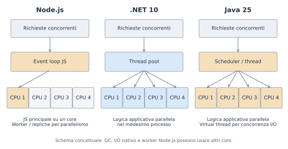
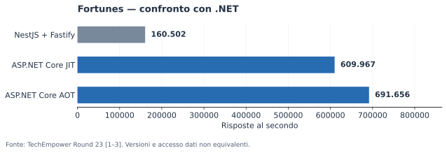
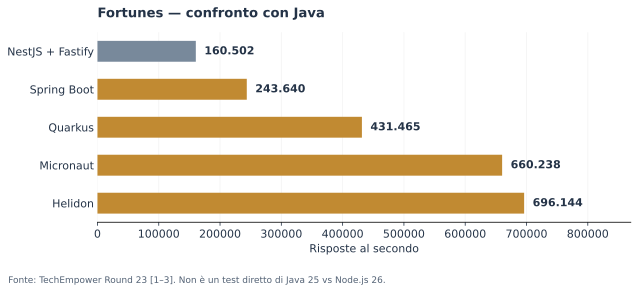
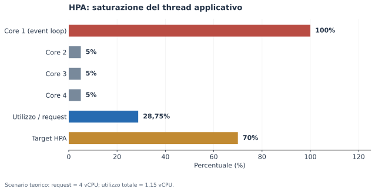
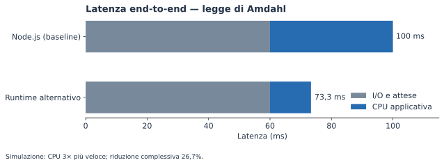
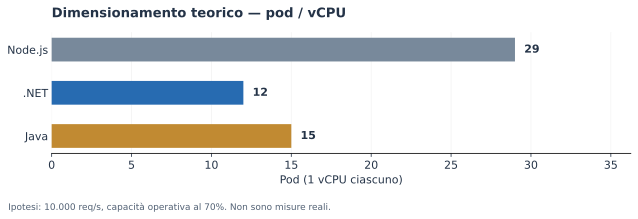
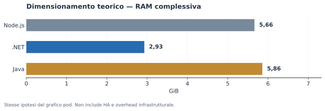

# SBE Next — Valutazione prestazionale dello stack backend

**Data:** 24 novembre 2026  
**Oggetto:** confronto separato Node.js/NestJS vs .NET 10 e Node.js/NestJS vs Java 25.

## 1. Sintesi esecutiva

Lo stack SBE Next, così come descritto nella documentazione analizzata, adotta TypeScript, Node.js e NestJS, con microservizi gRPC, PostgreSQL e Kubernetes. È una soluzione valida per servizi prevalentemente I/O-bound, ma la sua adozione generalizzata nei domini transazionali e computazionali richiede una verifica prestazionale specifica.

- **Rispetto a .NET 10:** preferenza tecnica preliminare per .NET nei servizi critici, per parallelismo multicore, capacità elaborativa e potenziale efficienza infrastrutturale.
- **Rispetto a Java 25:** preferenza preliminare per Java nei servizi di business complessi; NestJS resta competitivo nell'orchestrazione leggera e può avere vantaggi rispetto a Spring Boot JVM in memoria a riposo e avvio.
- **Decisione finale:** subordinata a benchmark applicativi a parità di SLA, risorse e funzionalità. Non sono disponibili in questa analisi misurazioni dirette del codice SBE Next.

## 2. Stack di riferimento

| Componente | SBE Next (dichiarato) | Alternativa .NET | Alternativa Java |
|---|---|---|---|
| Linguaggio | TypeScript 6 | C# 14 | Java 25 LTS |
| Runtime | Node.js 26 | .NET 10 LTS | JVM 25 |
| Framework | NestJS 11 | ASP.NET Core 10 | Spring Boot 4 |
| ORM | MikroORM 7 | EF Core 10 | Hibernate |
| Accesso SQL | Kysely | Dapper / Npgsql | jOOQ / JDBC |
| RPC | nice-grpc / grpc-js | gRPC ASP.NET Core | grpc-java / Netty |
| Database | PostgreSQL | PostgreSQL | PostgreSQL |
| Cache / broker | Valkey / NATS JetStream | Invariati | Invariati |
| Infrastruttura | Kubernetes / Envoy | Invariata | Invariata |

Le versioni SBE Next provengono dalla precedente analisi documentale, non dall'ispezione delle dipendenze installate. Angular e gli altri componenti infrastrutturali non sono considerati differenzianti.

## 3. Valutazione A — Node.js / NestJS vs .NET 10

### 3.1 Modello di esecuzione

Node.js esegue normalmente il codice JavaScript applicativo su un event loop principale per isolate. L'I/O asincrono permette di gestire molte richieste concorrenti, ma una computazione sincrona prolungata può ritardare tutte le richieste servite dallo stesso event loop. Componenti nativi, garbage collector e worker possono utilizzare altri core; per parallelizzare la logica JavaScript servono worker, processi multipli o repliche [4][5].

.NET utilizza un thread pool e I/O asincrono; più richieste possono elaborare codice applicativo in parallelo nello stesso processo. Questo facilita lo sfruttamento di più vCPU, la condivisione delle cache e dei pool di connessioni, pur senza eliminare i rischi di saturazione, contesa e thread pool starvation. .NET 10 comprende inoltre ottimizzazioni JIT, GC e librerie [6][7].

| Aspetto | Valutazione preliminare |
|---|---|
| Orchestrazione I/O-bound | Entrambi competitivi |
| CRUD semplice | Dipende soprattutto da query, ORM e database |
| Calcolo tariffario / elaborazione in memoria | Vantaggio potenziale .NET |
| Parallelismo multicore per processo | .NET favorito senza worker applicativi dedicati |
| Latenza p95/p99 sotto carico CPU | .NET potenzialmente favorito |
| Serializzazione | Da misurare con payload e librerie reali |
| Cold start / RAM a riposo | Entrambi competitivi; dipende dalle configurazioni |
| Scalabilità orizzontale | Entrambi validi |
| Batch e importazioni | .NET favorito quando prevale CPU applicativa |

### 3.2 Benchmark esterno

TechEmpower Round 23, test Fortunes (query al database, elaborazione e rendering HTML), risultati selezionati [1][2][3]:

| Implementazione | Risposte/s | Rapporto vs NestJS |
|---|---:|---:|
| NestJS + Fastify + PostgreSQL | 160.502 | 1,00× |
| ASP.NET Core Minimal API JIT | 609.967 | 3,80× |
| ASP.NET Core Native AOT | 691.656 | 4,31× |

**Limiti:** benchmark precedente alle versioni target, non gRPC, implementazioni con livelli di astrazione e accesso dati differenti. La variante NestJS è classificata Full ORM; le varianti ASP.NET selezionate non sono necessariamente equivalenti a un servizio EF Core. I rapporti non sono stime delle prestazioni di SBE Next, né dimostrano un risparmio CPU della stessa entità. Native AOT va valutato anche per compatibilità delle librerie e dell'ORM.

### 3.3 Giudizio

Per il nucleo transazionale, .NET 10 è la scelta preliminare preferita sotto il profilo prestazionale. NestJS rimane valido per servizi leggeri e I/O-bound. La superiorità effettiva deve essere dimostrata con carichi rappresentativi.

## 4. Valutazione B — Node.js / NestJS vs Java 25

### 4.1 Modello di esecuzione

Java dispone di parallelismo multicore nativo, JIT e garbage collector come G1 e ZGC. I virtual thread, disponibili da Java 21, consentono di gestire numerose operazioni concorrenti in attesa di I/O con minore dipendenza dai thread di sistema. Non accelerano le computazioni CPU-bound, né rendono automaticamente asincrone tutte le librerie; occorre verificare la configurazione del framework e dei driver [8].

| Aspetto | Valutazione preliminare |
|---|---|
| Orchestrazione I/O-bound | NestJS e Java moderno competitivi |
| CRUD | Dipende da ORM e database |
| Calcolo tariffario / elaborazioni massive | Java potenzialmente favorito |
| Parallelismo multicore | Java favorito senza worker applicativi dedicati |
| Latenza di coda sotto carico CPU | Java potenzialmente favorito |
| RAM a riposo / cold start | NestJS spesso favorito rispetto a Spring Boot JVM |
| Framework cloud-native | Quarkus, Micronaut e Helidon da considerare |
| Scalabilità orizzontale | Entrambi validi |

### 4.2 Benchmark esterno

Stesso test Fortunes, Round 23; varianti selezionate, non necessariamente equivalenti per ORM e configurazione [1][2][3].

| Implementazione | Risposte/s | Rapporto vs NestJS |
|---|---:|---:|
| NestJS + Fastify + PostgreSQL | 160.502 | 1,00× |
| Spring Boot | 243.640 | 1,52× |
| Quarkus | 431.465 | 2,69× |
| Micronaut | 660.238 | 4,11× |
| Helidon | 696.144 | 4,34× |

Il confronto evidenzia il peso delle scelte di framework e implementazione. I numeri non misurano direttamente Java 25 contro Node.js 26, né sono una previsione di latenza o capacità di un microservizio SBE Next.

### 4.3 Giudizio

Per servizi di business complessi e CPU-intensive, Java è preliminarmente preferibile. Per servizi CRUD poco utilizzati e orchestrazione, NestJS può essere altrettanto appropriato. Quarkus e altre soluzioni cloud-native possono ridurre il costo di avvio e memoria, anche mediante compilazione nativa, da valutare separatamente dal throughput a regime.

## 5. Implicazioni Kubernetes e gRPC

### 5.1 HPA e saturazione dell'event loop

Un pod Node.js con CPU request di 4 vCPU e un event loop saturo potrebbe consumare circa 1,15 vCPU complessive (ipotizzando 0,15 vCPU di lavoro accessorio): l'utilizzo rispetto alla request sarebbe appena 28,75%, inferiore a un target HPA del 70%. Il thread applicativo potrebbe quindi essere già saturo senza attivare lo scaling CPU [9].

Possibili mitigazioni: dimensionare le request sulla capacità realmente sfruttata, usare repliche o worker, monitorare event loop lag/utilization, richieste in-flight e code, introdurre metriche HPA personalizzate. Anche Java e .NET possono saturare risorse specifiche prima di raggiungere il target CPU.

### 5.2 gRPC e bilanciamento

Il progetto gRPC pubblica benchmark multilanguage comprendenti Node.js, Java e C#, con scenari unary e streaming [10][11]. Sono più pertinenti al trasporto interno di SBE Next dei benchmark HTTP, ma occorre verificare versione e implementazione effettiva (in particolare grpc-js e Grpc.AspNetCore), perché i risultati di altre implementazioni non sono automaticamente trasferibili.

Riutilizzare i canali, verificare i limiti HTTP/2 e il bilanciamento tra repliche: un bilanciatore L4 opera sulle connessioni TCP, non sulle singole RPC multiplexate. Valutare bilanciamento client-side o proxy L7 [12][13].

### 5.3 Latenza end-to-end

Esempio teorico: transazione da 100 ms, di cui 40 ms di CPU applicativa e 60 ms di rete/database/cache. Accelerando la sola CPU di 3× si ottengono 73,3 ms (-26,7%), non 33,3 ms.

Formula (legge di Amdahl): `T_new = T_old × [(1 - f) + f / s]`, dove `f` è la quota accelerabile e `s` il fattore di accelerazione. Il modello non include accodamento e saturazione.

Una catena CLIENT → ILM → BACKEND con numerose chiamate sincrone può essere più determinante della scelta del runtime. Misurare gli span di rete, autorizzazione, serializzazione, elaborazione e persistenza separatamente.

## 6. Domini applicativi da sottoporre a verifica

| Servizio | Priorità di benchmark | Motivazione |
|---|---|---|
| afc-ticketing | Alta | Validazioni, picchi e SLA di latenza |
| afc-selling | Alta | Motore tariffario e itinerari |
| afc-clearing | Alta | Elaborazioni massive e aggregazioni |
| net-physical-tier | Alta | Importazione ed elaborazione reti / GTFS |
| afc-catalog | Medio-alta | Regole tariffarie |
| core-background | Variabile | Dipende dai job |
| afc-mediamanagement | Media | Volumi transazionali |
| afc-wallet | Media | Concorrenza e consistenza |
| afc-payments | Bassa-media | Attese verso gateway esterni |
| afc-customers / core-contacts | Bassa-media | Prevalenza CRUD |
| core-configmanager | Bassa | Carico generalmente contenuto |
| ilm-admin-* | Bassa-media | Orchestrazione e I/O |

Priorità dedotte dalle responsabilità funzionali, non da anomalie misurate. Se le aggregazioni sono eseguite in PostgreSQL, il runtime potrebbe incidere poco.

## 7. Dimensionamento: esempio teorico

Ipotesi: 10.000 richieste/s, 1 vCPU per pod, capacità operativa al 70% del massimo ipotizzato. Nessuno dei valori seguenti è un benchmark reale.

| Stack | Capacità ipotetica/pod (req/s) | RAM/pod (MiB) | Pod / vCPU | RAM totale (GiB) |
|---|---:|---:|---:|---:|
| Node.js | 500 | 200 | 29 | 5,66 |
| .NET | 1.250 | 250 | 12 | 2,93 |
| Java | 1.000 | 400 | 15 | 5,86 |

Formula: `pod = ceil(traffico / (capacità per pod × 0,70))`.

L'esempio mostra come una RAM inferiore per singolo processo non implichi un costo complessivo inferiore. Non include HA, overhead, limiti del database e scaling non lineare. Il KPI economico da adottare è il costo per milione di transazioni riuscite rispettando lo stesso SLA.

## 8. Proof of Concept comparativo

| Test | Scenario |
|---|---|
| T01 | Validazione titolo, regole, aggiornamento DB |
| T02 | Vendita, ricerca prodotto, calcolo tariffario ed emissione |
| T03 | ILM con cinque RPC downstream, sia sequenziali sia parallelizzabili |
| T04 | Importazione GTFS e relazioni di rete |

Condizioni: stessi contratti Protobuf, dati, query e indici, consistenza transazionale, autenticazione, logging, tracing, pool, rete e hardware. Eseguire build Release/production; fissare versioni e configurazioni. Testare 1, 2 e 4 vCPU, sia singolo pod sia più repliche; includere Node.js con worker/processi opportunamente dimensionati. Confrontare ORM equivalenti e accesso SQL diretto in prove distinte.

Eseguire warm-up, carico crescente a tasso di arrivo controllato, regime stabile, picchi e soak test; ripetere almeno tre volte. Separare avvio a freddo e regime. Evitare coordinated omission e verificare che il generatore di carico non sia il collo di bottiglia.

Metriche:

- throughput sostenibile entro SLA e tasso di errori;
- latenza p50, p95, p99 e p99.9, timeout e code;
- CPU-secondi per transazione riuscita, RSS/working set, allocazioni e GC;
- event loop lag/utilization, thread pool, connessioni DB e HTTP/2;
- numero di repliche, scaling, recupero dopo picchi e interferenza dei job batch;
- costo per milione di transazioni e correttezza dei risultati.

Definire prima le soglie SLA insieme ai responsabili del sistema, evitando di scegliere il vincitore sulla base del solo throughput massimo.

## 9. Conclusioni

L'architettura proto-first rende possibile l'adozione di più runtime senza cambiare i contratti RPC. Una soluzione da valutare è NestJS per ILM e CRUD leggeri, .NET 10 o Java per motori tariffari, validazione, clearing e batch. Il vantaggio potenziale deve essere bilanciato con il costo di manutenzione, competenze, librerie condivise e standard operativi di una piattaforma poliglotta.

**La criticità non è Node.js in sé, ma l'eventuale scelta di un unico runtime per tutti i domini senza evidenze prestazionali rappresentative.** Nessun benchmark esterno sostituisce le misure sul sistema reale.

## 10. Riferimenti esterni

### Benchmark e risultati riproducibili

1. [TechEmpower — Round 23, risultati](https://www.techempower.com/benchmarks/?section=data-r23) — selezionare Fortunes; fonte primaria per i risultati e le caratteristiche delle implementazioni.
2. [TechEmpower — pubblicazione Round 23](https://github.com/TechEmpower/FrameworkBenchmarks/issues/9589) e [run originale](https://tfb-status.techempower.com/results/91a66052-9d86-446c-b31a-eadbd669ed08) — identificazione della sessione di benchmark.
3. [Irurueta Docs — Backend Frameworks Comparison](https://www.irurueta.com/backend/frameworks-comparison.html) — riepilogo secondario dei migliori risultati Fortunes per framework, utilizzato per le varianti .NET e Java sopra riportate. Verificare i singoli test nel dataset primario prima di usare i numeri in una decisione formale.

### Documentazione tecnica e benchmark dei runtime

4. [Node.js — Don't Block the Event Loop](https://nodejs.org/learn/asynchronous-work/dont-block-the-event-loop) — modello di concorrenza e rischio di blocco.
5. [Node.js — Worker threads](https://nodejs.org/api/worker_threads.html) — parallelismo per elaborazioni CPU-intensive.
6. [Microsoft — Performance Improvements in .NET 10](https://devblogs.microsoft.com/dotnet/performance-improvements-in-net-10/) — microbenchmark e ottimizzazioni con esempi; fonte del produttore, non confronto indipendente tra stack.
7. [Microsoft Learn — What's new in .NET 10 runtime](https://learn.microsoft.com/en-us/dotnet/core/whats-new/dotnet-10/runtime) — caratteristiche e ottimizzazioni runtime.
8. [Oracle — Java 25 Virtual Threads](https://docs.oracle.com/en/java/javase/25/core/virtual-threads.html) — concorrenza e limiti delle elaborazioni CPU-bound.
9. [Kubernetes — Horizontal Pod Autoscaling](https://kubernetes.io/docs/concepts/workloads/autoscaling/horizontal-pod-autoscale/) — metriche, CPU request e scaling.
10. [gRPC — Benchmarking](https://grpc.io/docs/guides/benchmarking/) — metodologia, dashboard multilanguage e scenari di test.
11. [gRPC — Performance benchmarks on GKE](https://grpc.io/blog/performance-benchmarks-gke/) — infrastruttura e riproducibilità dei test RPC.
12. [gRPC — Performance Best Practices](https://grpc.io/docs/guides/performance/) — riutilizzo canali e prestazioni RPC.
13. [Microsoft Learn — Performance best practices with gRPC](https://learn.microsoft.com/en-us/aspnet/core/grpc/performance) — multiplexing HTTP/2 e bilanciamento.

Ulteriore materiale per riprodurre i test: [repository sorgente TechEmpower FrameworkBenchmarks](https://github.com/TechEmpower/FrameworkBenchmarks) e [metodologia del progetto](https://github.com/TechEmpower/FrameworkBenchmarks/wiki/About-Benchmarks-Project).

---

*Nota metodologica: valutazioni qualitative, dati esterni e simulazioni sono distinti esplicitamente. Fonti web consultate il 24 novembre 2026. Il documento non certifica prestazioni o consumi effettivi di SBE Next.*
